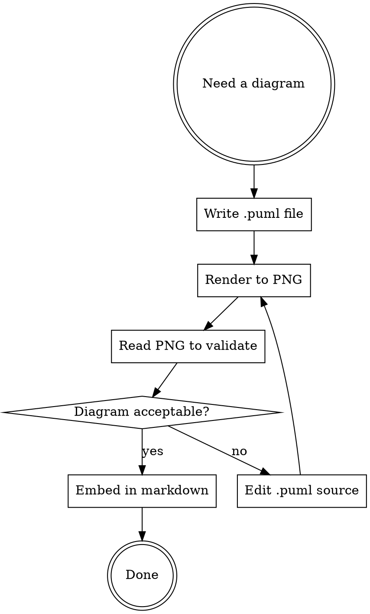

# PlantUML Diagrams

Create, render, validate, and embed PlantUML diagrams in planning/documentation files.

## PlantUML Setup

**Requirement:** `plantuml` must be on PATH. Install via `brew install plantuml` if missing.

**NEVER send diagrams to public PlantUML servers.** Always render locally.

## Rendering Commands

```bash
plantuml -tpng -o <output_dir> <input.puml>
plantuml -tsvg -o <output_dir> <input.puml>
```

Output filename is derived from the `@startuml <name>` declaration or the input filename.

## Workflow



### Steps

1. **Write** the `.puml` source file in a `diagrams/` subdirectory next to the plan
2. **Render** to PNG using the jar
3. **Validate** by reading the PNG with the Read tool — visually inspect layout, labels, relationships
4. **Iterate** if the diagram is unclear, mislabeled, or has layout issues — edit the `.puml` and re-render
5. **Embed** in the markdown plan using a relative image link

**You MUST read the rendered image and visually verify it before embedding.** Do not skip validation.

## File Organization

Place diagram sources and rendered images together, next to the plan:

```
plan/
  my-plan.md
  diagrams/
    architecture.puml
    architecture.png
    sequence.puml
    sequence.png
```

## Embedding in Markdown

Use relative paths from the plan file to the rendered image:

```markdown

```

For plans that reference the `.puml` source, link both:

```markdown


*Source: [architecture.puml](./diagrams/architecture.puml)*
```

## Quick Reference: Diagram Types

| Type | PlantUML keyword | Good for |
|------|-----------------|----------|
| Component | `@startuml` + `component` | Architecture, system boundaries |
| Sequence | `@startuml` + `->` arrows | API flows, request/response |
| Activity | `@startuml` + `:action;` | Workflows, decision trees |
| Class | `@startuml` + `class` | Data models, type relationships |
| State | `@startuml` + `state` | Lifecycle, state machines |
| Deployment | `@startuml` + `node` | Infrastructure, deployment topology |

## Common Mistakes

- **Not validating**: Writing puml and embedding without checking the render
- **Missing `plantuml` on PATH**: Verify with `which plantuml`; install via `brew install plantuml` if missing
- **Public servers**: Never use `plantuml.com/plantuml/` for rendering — keep diagrams local
- **Wrong output dir**: Use `-o <dir>` to control where the PNG lands; without it, the PNG goes next to the `.puml` file (which is usually fine if diagrams/ is the right place)
- **Missing `@startuml` name**: Always use `@startuml <name>` — the name controls the output filename
